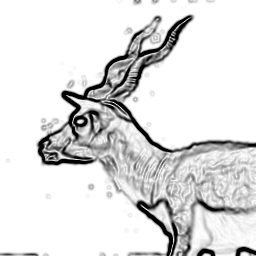
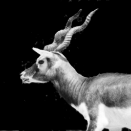
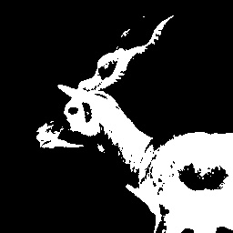
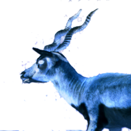
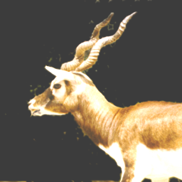
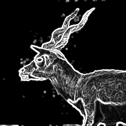
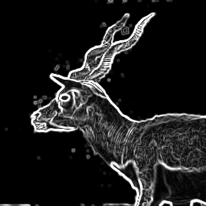
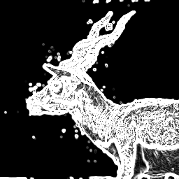
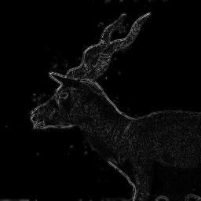
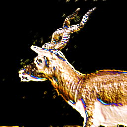

# darkroom

a small image processing library in c, with a command line tool on top. it
reads and writes 24 bit bmp files and has no dependencies besides the c
standard library and libm.

<p align="center"></p>

every image below was made from this one with the `darkroom` tool, using the
command shown under it.

## building

```sh
mkdir build && cd build
cmake ..
cmake --build .
ctest            # run the tests
```

this builds:

- `libdarkroom.a`, the library
- `darkroom`, the command line tool
- `apply_filters`, a small example program that writes one image per filter
- `test_bmp_image`, the tests

## command line

```sh
darkroom <input.bmp> <output.bmp> [operation...]
```

operations run left to right, so they can be chained:

```sh
darkroom photo.bmp out.bmp --resize 50% --gblur 1 --edge --invert
```

<p align="center"></p>

the whole command line is checked before the input is read, and nothing is
written if any operation fails. `darkroom --help` lists every operation.

| operation | argument | what it does |
| --- | --- | --- |
| `--bw` | | black and white |
| `--binary` | `<threshold>` | pure black or white around a 0-255 threshold |
| `--invert` | | colour negative |
| `--brightness` | `<delta>` | add delta to every channel, can be negative |
| `--blur` | `<size>` | box blur, size must be odd |
| `--gblur` | `<sigma>` | gaussian blur |
| `--sharpen` | | 3x3 sharpen kernel |
| `--unsharp` | `<sigma>,<amount>` | unsharp mask |
| `--emboss` | | raised relief look |
| `--edge` | | sobel edge detection |
| `--prewitt` | | prewitt edge detection |
| `--scharr` | | scharr edge detection |
| `--laplacian` | | laplacian edge detection |
| `--flip-h`, `--flip-v` | | mirror left to right, top to bottom |
| `--resize` | `<w>x<h>` or `<percent>%` | bilinear resize |
| `--crop` | `<x>,<y>,<w>,<h>` | keep a rectangle, x and y from the top left |
| `--rotate` | `<degrees>` | clockwise, multiples of 90, negative for counterclockwise |

## examples

### colour

| `--bw` | `--binary 100` | `--invert` | `--brightness 60` |
| :---: | :---: | :---: | :---: |
|  |  |  |  |

### blur and sharpen

| `--blur 7` | `--gblur 3` | `--sharpen` | `--unsharp 2,2` |
| :---: | :---: | :---: | :---: |
|  |  |  |  |

### edges

| `--edge` | `--prewitt` | `--scharr` | `--laplacian` |
| :---: | :---: | :---: | :---: |
|  |  |  |  |

sobel, prewitt and scharr look for changes horizontally and vertically and
combine the two. scharr weighs the centre row and column the most, so it
picks up the most edges and the most noise. laplacian uses a single kernel
for every direction, which gives thinner, fainter lines.

### geometry and effects

| `--emboss` | `--flip-h` | `--rotate 90` |
| :---: | :---: | :---: |
|  |  |  |

| `--crop 60,10,160,120` | `--resize 128x64` |
| :---: | :---: |
|  |  |

## library

```c
#include "bmp_image.h"

int
main (void)
{
  struct bmp_image *image = read_img ("photo.bmp");
  if (!image)
    return 1;

  if (resize (image, 640, 480) != 0 || unsharp_mask (image, 1.5, 1.0) != 0
      || write_img (image, "out.bmp") != 0)
    {
      free_img (image);
      return 1;
    }
  free_img (image);
  return 0;
}
```

link against `darkroom` and `m`. with cmake:

```cmake
target_link_libraries(your_program darkroom)
```

all functions are declared in `src/include/bmp_image.h`. the ones that can
fail print the reason to stderr and return null or -1, and leave the image
as it was.

| function | |
| --- | --- |
| `read_img`, `write_img`, `copy_img`, `free_img` | load, save, duplicate and free images |
| `convert_to_bw`, `convert_to_binary`, `invert`, `adjust_brightness` | per pixel colour changes |
| `blur`, `box_blur`, `g_blur`, `sharpen`, `unsharp_mask` | blur and sharpen |
| `v_edge`, `h_edge`, `edge`, `prewitt_edge`, `scharr_edge`, `laplacian` | edge detection |
| `emboss` | relief effect |
| `convolve` | apply any odd sized kernel |
| `resize`, `crop`, `rotate`, `flip_horizontal`, `flip_vertical`, `concat` | geometry |

`convolve` takes a row-major kernel, so custom filters are a few lines:

```c
const double ridge[3][3] = { { -1, -1, -1 }, { -1, 8, -1 }, { -1, -1, -1 } };
convolve (image, &ridge[0][0], 3);
```

pixels outside the image take the value of the nearest edge pixel, and the
result is stored as its absolute value clamped to 0-255.

## limitations

- only uncompressed 24 bit bmp files can be read. 8 bit (palette) and 32 bit
  bmps are rejected with an error.
- images are kept fully in memory as one row per allocation.
